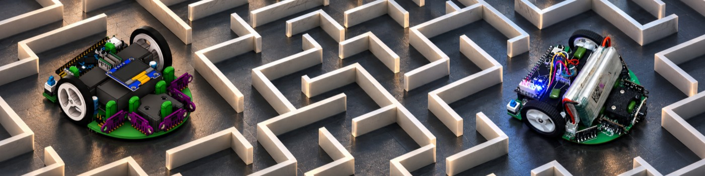

  

  <h1>Kaveesha Ginodh</h1>
  
BSc (Hons) in Artificial Intelligence at the University of Moratuwa

  
I build at the intersection of AI, software, and hardware.

  
  
  

---

### About me

- Studying **BSc (Hons) in Artificial Intelligence** at the **University of Moratuwa**.
- Building projects across **AI, web apps, embedded systems, robotics, and computer vision**.
- Based in **Sri Lanka**.

### Tech stack

  
  

### Selected projects

| Project | What it does |
| --- | --- |
| [**AirTrixx**](https://github.com/Kavee-ginty/AirTrixx) | A multi-device ESP32 and Python prototype for gesture-aware laptop control. |
| **MediSync** (private) | An offline-first clinic management desktop app with SQLite, LAN access, and cloud synchronization. |
| **NutriLens** (private) | A handheld plant nutrient deficiency diagnostic system combining leaf imagery, soil sensors, and offline AI inference. |
| [**Elora**](https://github.com/Tenzrr/Elora) | A team-built Flutter and FastAPI app for crop intelligence, farming advice, and plant records. |
| [**Hawky**](https://github.com/Kavee-ginty/Hawky) | A WhatsApp project management agent that turns team conversations into Notion tasks and updates. |
| **MicroMouse** (private) | An STM32-based autonomous maze-solving robot with time-of-flight sensors and encoder feedback. |
| [**Memora**](https://github.com/Kavee-ginty/Memora) | A spaced-repetition learning app for Sri Lankan A/L Physics, built with Flutter and FastAPI. |
| [**PCB Autorouter Visualizer**](https://github.com/Kavee-ginty/PCB_Autorouter_Search_Algorithm_Visualizer) | An interactive PCB routing playground that shows pathfinding algorithms step by step. |
| [**Defense Panel**](https://github.com/Kavee-ginty/DefensePanel) | An AI-powered practice panel for pitches, interviews, and vivas. |
| [**AutoGen Shopping**](https://github.com/Kavee-ginty/AutoGenShopping) | A learning project exploring AI shopping workflows and tool calling. |

### GitHub at a glance

  
  

### Contribution trail

<picture>
  <source media="(prefers-color-scheme: dark)" srcset="https://raw.githubusercontent.com/Kavee-ginty/Kavee-ginty/output/github-snap-dark.svg" />
  
</picture>
