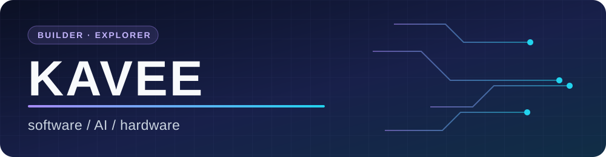

  

  <h1>Hey, I'm Kavee 👋</h1>
  
I turn curious ideas into useful software and hands-on hardware projects.

  
  

---

### ✦ A little about me

- 🤖 I like projects where **AI, interfaces, and physical devices** meet.
- 🛠️ I build across **Python, web apps, embedded systems, and computer vision**.
- 📍 Based in **Sri Lanka**.

### 🧰 Tools I reach for

  

### 🚀 Selected projects

| Project | What it does |
| --- | --- |
| [**UniMate**](https://github.com/Kavee-ginty/Unimate) | A Raspberry Pi smart desk companion with a touchscreen, sensors, device controls, and voice features. |
| [**AirTrixx**](https://github.com/Kavee-ginty/AirTrixx) | A multi-device ESP32 and Python prototype for gesture-aware laptop control. |
| [**Memora**](https://github.com/Kavee-ginty/Memora) | A spaced-repetition learning app for Sri Lankan A/L Physics, built with Flutter and FastAPI. |
| [**PCB Autorouter Visualizer**](https://github.com/Kavee-ginty/PCB_Autorouter_Search_Algorithm_Visualizer) | An interactive PCB routing playground that shows pathfinding algorithms step by step. |
| [**Defense Panel**](https://github.com/Kavee-ginty/DefensePanel) | An AI-powered practice panel for pitches, interviews, and vivas. |
| [**AutoGen Shopping**](https://github.com/Kavee-ginty/AutoGenShopping) | A learning project exploring AI shopping workflows and tool calling. |

### 📊 GitHub at a glance

  
  

### 🐍 Contribution trail

<picture>
  <source media="(prefers-color-scheme: dark)" srcset="https://raw.githubusercontent.com/Kavee-ginty/Kavee-ginty/output/github-snake-dark.svg" />
  
</picture>

  Always building, always learning. ✨

